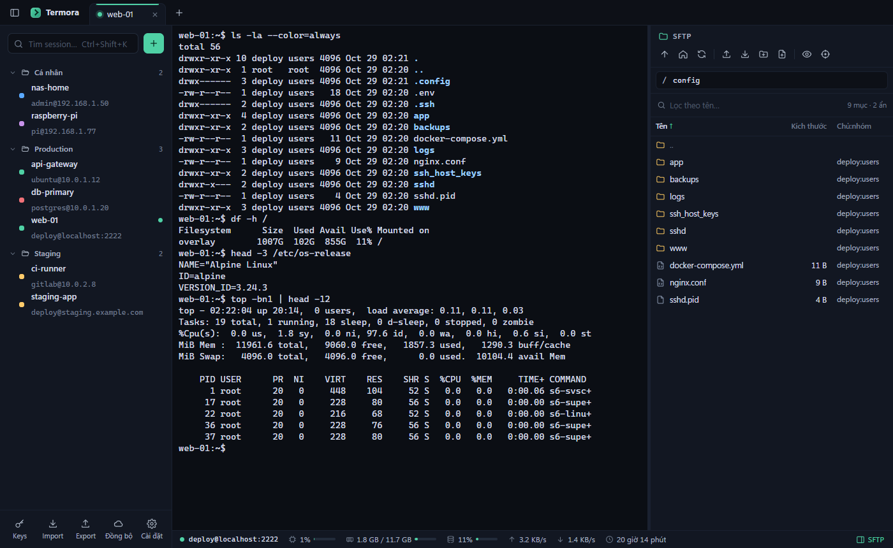
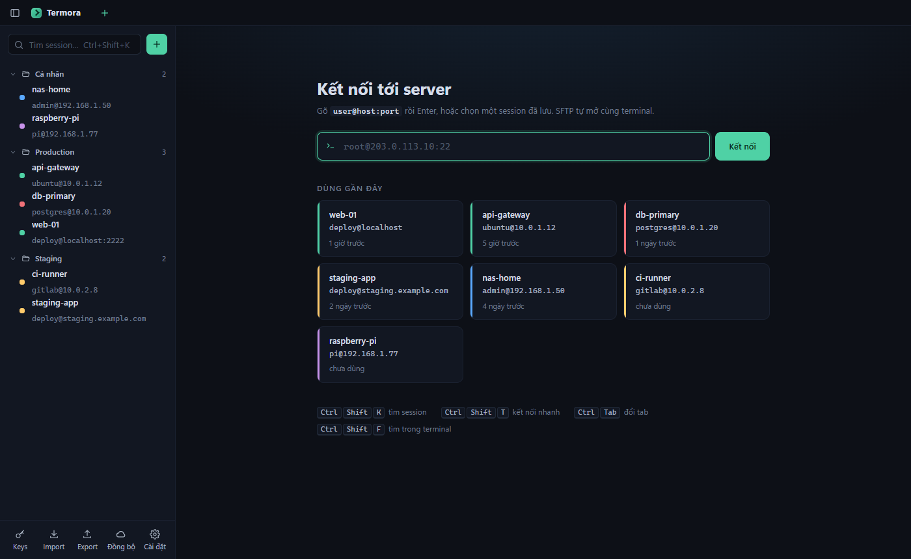
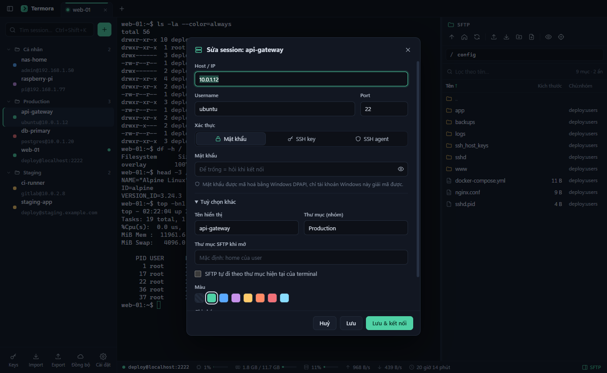

# Termora

SSH client cho Windows: đăng nhập SSH là tự mở SFTP bên cạnh terminal.



<table>
  <tr>
    <td></td>
    <td></td>
  </tr>
  <tr>
    <td align="center">Session nhóm theo thư mục, kết nối nhanh</td>
    <td align="center">Sửa session: mật khẩu, SSH key, SSH agent</td>
  </tr>
</table>

## Tính năng

- **Terminal**: xterm.js, 256 màu, tìm kiếm (Ctrl+Shift+F), bôi đen là copy, chuột phải để dán, Ctrl+C/Ctrl+V thông minh, zoom chữ bằng Ctrl+= / Ctrl+-.
- **SFTP tự mở** ngay khi kết nối, chung một kết nối TCP với terminal. Có các thao tác:
  - duyệt thư mục, sắp xếp, lọc theo tên, hiện/ẩn file ẩn
  - kéo thả file/thư mục từ Explorer để upload (thả lên một thư mục thì upload vào thư mục đó)
  - tải xuống cả thư mục, đổi tên, xoá, chmod, tạo file/thư mục
  - mở file bằng editor của Windows; mỗi lần lưu là tự upload lại lên server
  - **theo thư mục terminal**: `cd` ở terminal thì SFTP nhảy theo. Không chèn lệnh nào vào shell nên không bẩn history.
- **Thanh trạng thái**: CPU, RAM, ổ đĩa `/`, tốc độ mạng lên/xuống, uptime của server (Linux).
- **Session**: lưu nhiều session, nhóm theo thư mục lồng nhau (`Khách hàng/Potech`), kéo thả session vào thư mục, gắn màu, tìm nhanh (Ctrl+Shift+K), kết nối nhanh bằng `user@host:port`.
- **Mật khẩu & key**: mã hoá bằng Windows DPAPI (`safeStorage`). Quản lý SSH key gồm:
  - tạo key Ed25519/RSA/ECDSA; import file OpenSSH/PEM/PuTTY `.ppk` hoặc dán key
  - copy public key, nút "Cài lên server" để ghi vào `~/.ssh/authorized_keys`
  - hỗ trợ đăng nhập qua SSH agent
- **Bảo mật host key**: lần đầu hỏi xác nhận fingerprint; nếu key đổi thì cảnh báo MITM.
- **Import / export**:
  - export ra file `.termora`, có thể kèm mật khẩu và key, mã hoá AES-256-GCM + scrypt bằng passphrase
  - import từ `.termora`, file bookmark `.mxtsessions` / `.ini` (giữ nguyên cây thư mục) và `~/.ssh/config`
- **Đồng bộ qua thư mục cloud** (Google Drive, OneDrive, Dropbox…): session, mật khẩu, key được lưu thành file `termora-sync.termora` mã hoá bằng mật khẩu đồng bộ. Các máy trỏ vào cùng thư mục sẽ tự gộp hai chiều (mục sửa sau thắng, xoá ở một máy thì máy kia cũng xoá).
- **Tự cập nhật** từ GitHub Releases. Bản cài tải ngầm, khởi động lại là xong. Bản portable tải exe mới về rồi chép đè lên file đang dùng; `TermoraData` giữ nguyên.

## Chạy / build

```bash
npm install
node node_modules/electron/install.js   # npm 11 chặn script cài binary của Electron
npm start
npm run dist                            # ra dist/Termora-Setup-x.y.z.exe, Termora-portable-x.y.z.exe, latest.yml
```

Phát hành bản mới: tăng `version`, `npm run dist`, rồi tạo GitHub Release `vX.Y.Z` đính kèm `Termora-Setup-X.Y.Z.exe`, `Termora-Setup-X.Y.Z.exe.blockmap`, `latest.yml` (bản cài cần file này để tự cập nhật) và `Termora-portable-X.Y.Z.exe`.

Dữ liệu nằm ở `%APPDATA%\Termora\data.json`. Bản portable lưu vào thư mục `TermoraData` cạnh file `.exe`. Mật khẩu trong đó chỉ giải mã được trên đúng tài khoản Windows đã lưu, nên muốn chuyển sang máy khác (hoặc giữa bản cài và bản portable) thì dùng Export / Import hoặc bật đồng bộ.

## Cấu trúc

| File | Vai trò |
|---|---|
| `src/main.js` | Cửa sổ, IPC, hộp thoại file |
| `src/ssh.js` | Một tab = một kết nối: shell, SFTP, monitor, theo dõi thư mục, truyền file |
| `src/store.js` | Lưu session/key/known hosts, mã hoá bí mật |
| `src/importexport.js` | Định dạng `.termora`, parser file bookmark và ssh config |
| `src/sync.js` | Đồng bộ qua thư mục cloud: mã hoá file, gộp theo `updatedAt` và dấu xoá |
| `src/updater.js` | Tự cập nhật: electron-updater cho bản cài, tự tải và chép đè cho bản portable |
| `src/renderer/` | Giao diện (HTML/CSS/JS thuần, không cần bundler) |
